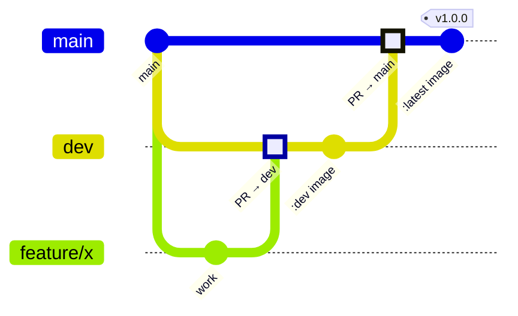
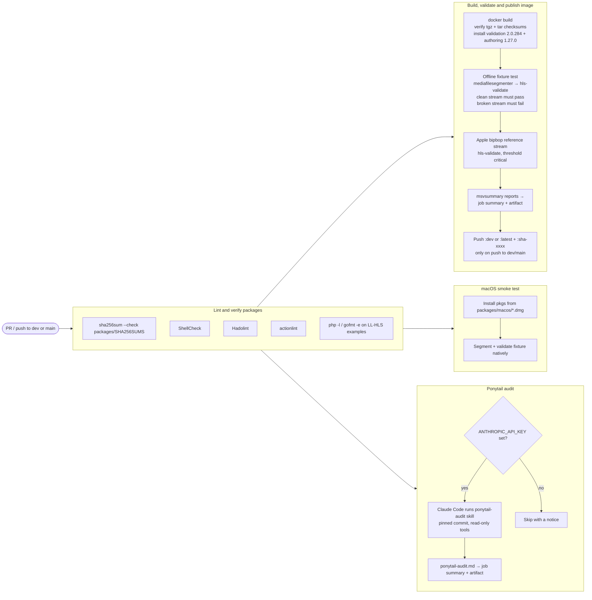
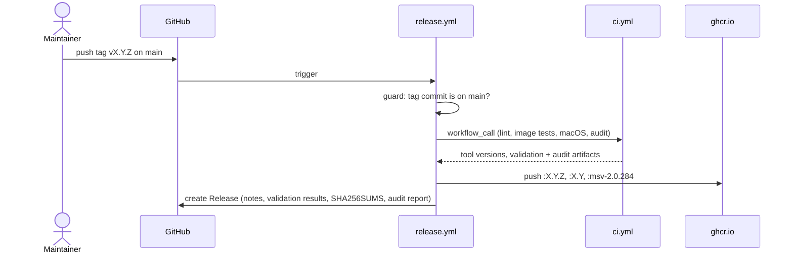

# CI/CD pipeline

Three workflows in `.github/workflows/` make up the pipeline:

| Workflow | Runs on | What it does |
|:---------|:--------|:-------------|
| `ci.yml` | pull requests, pushes to `dev` and `main`, manual runs, and calls from `release.yml` | Lints, builds the image, validates streams, smoke-tests the macOS installers, runs the Ponytail audit, and publishes `:dev` or `:latest` |
| `release.yml` | `vX.Y.Z` tags | Re-runs `ci.yml` on the tagged commit, publishes versioned images and creates the GitHub Release |
| `ponytail-audit.yml` | called by `ci.yml`, weekly schedule, manual runs | Whole-repo audit with the Ponytail `ponytail-audit` skill, reported as a job summary and artifact |

`linux-rhel-ubuntu-debian` is treated the same as `main` until the Linux work is merged into `main`.

## Branch and release flow



1. Branch from `dev` and open a pull request into `dev`. CI runs; nothing is published.
2. Merging into `dev` publishes `ghcr.io/jamiefletchertv/apple-http-live-streaming-tools:dev`.
3. Open a pull request from `dev` into `main`. Merging publishes `:latest`.
4. Tag a commit on `main` with `vX.Y.Z` and push the tag. The release workflow refuses tags that are not on `main`.

```sh
git checkout main && git pull
git tag -a v1.0.0 -m "mediastreamvalidator 2.0.284"
git push origin v1.0.0
```

## What runs in CI



### Lint and verify packages

* `sha256sum --check packages/SHA256SUMS` makes sure the vendored Apple packages are the ones that were reviewed.
* ShellCheck covers `scripts/hls-validate` and `tests/*.sh`; Hadolint covers the `Dockerfile` (exceptions and reasons are in `.hadolint.yaml`); actionlint covers the workflows.
* The Low-Latency HLS example scripts get a syntax check only, since they are Apple's sample code.

### Image build and validation

The Docker build verifies each `.tgz` against `packages/SHA256SUMS`, then follows Apple's `installationReadMe.md` by checking the contained `.tar` against its own `.sha256` before installing. It fails if `mediastreamvalidator` or `mediafilesegmenter` report a different version than the `HLS_VALIDATION_VERSION` and `HLS_AUTHORING_VERSION` build arguments.

Two tests then run against the freshly built image:

| Test | Network | Gate |
|:-----|:--------|:-----|
| `tests/validate-local-fixture.sh` | none | Segments `tests/fixtures/testsrc-6s.mp4`, validates it with `--exit-code.threshold must` and expects a pass; then removes a segment from the playlist and expects the gate to fail. This proves the gate itself works. |
| `tests/validate-apple-reference-stream.sh` | Apple CDN | Validates Apple's bipbop HEVC example for 20 seconds and fails on `critical` or worse. Override with `HLS_EXIT_THRESHOLD` or `STREAM_URL`. |

Every `msvsummary` Markdown report is added to the job summary, and all JSON, Markdown and HTML reports are uploaded as the `hls-validation-results` artifact.

### macOS smoke test

`tests/install-macos-dmgs.sh` mounts every DMG in `packages/macos/`, installs the `.pkg` inside with `installer`, and the job then segments and validates the fixture with the native tools through the same `scripts/hls-validate`.

### Ponytail audit

[Ponytail](https://github.com/DietrichGebert/ponytail)'s `ponytail-audit` skill reviews the whole repository for bugs, security holes, scale problems, untested risky code, slow paths and code to delete. The workflow checks out the skill at a pinned commit (`PONYTAIL_REF`) and has Claude Code follow it with read-only tools plus permission to write `ponytail-audit.md`.

* It needs an `ANTHROPIC_API_KEY` repository secret. Without one the job is skipped with a notice, so forks and fresh clones stay green.
* It is report-only. "Must fix" findings raise a warning annotation but do not fail the pipeline.
* It also runs every Monday at 06:00 UTC and can be started by hand from the Actions tab.

To move to a newer Ponytail version, review the upstream diff and update `PONYTAIL_REF`.

## Release



The release body lists the bundled tool versions and the `docker pull` command; GitHub's generated notes list the merged pull requests.

## Updating Apple's tools

1. Download the new Debian `.tgz` packages and macOS DMGs from [Apple Developer Downloads](https://developer.apple.com/download/all/).
2. Replace the files in `packages/linux/` and `packages/macos/`.
3. Regenerate the checksums: `sha256sum packages/linux/* packages/macos/* > packages/SHA256SUMS`.
4. Update `HLS_VALIDATION_VERSION` and `HLS_AUTHORING_VERSION` in the `Dockerfile`.
5. Open a pull request into `dev`. CI proves the new tools install, segment, validate and gate correctly before anything is published.

## Repository settings this pipeline expects

* **Secrets:** `ANTHROPIC_API_KEY` for the Ponytail audit (optional).
* **Branches:** `dev` and `main`. Protect both and require the `Lint and verify packages`, `Build, validate and publish image` and `macOS package smoke test` checks.
* **Packages:** Actions needs write access to the GHCR package (Settings → Actions → General → Workflow permissions, or the package's own access settings).
