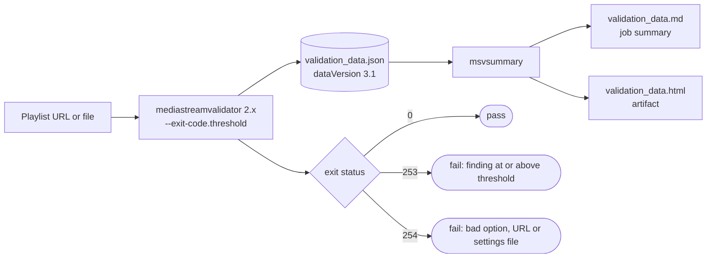

# mediastreamvalidator 2.x

The image ships **mediastreamvalidator 2.0.284** (HLS Tools validation package 2.0, build `2.0.284-260930`) together with **msvsummary**. The authoring tools come from the separate **1.27.0** authoring package. Apple's full user guide is installed in the image at `/usr/local/share/doc/hlstools/msv/` (start with `User_Guide.md`).

```sh
docker run --rm ghcr.io/jamiefletchertv/apple-http-live-streaming-tools:latest \
  sh -c 'ls /usr/local/share/doc/hlstools/msv; cat /usr/local/share/doc/hlstools/msv/Changes.md'
```

## What changed from 1.x

| | 1.x (1.26.143 and earlier) | 2.x |
|:--|:--|:--|
| Packaging | One `hlstools` package with every tool | Separate **validation** (`hlstools-validation`, mediastreamvalidator + msvsummary) and **authoring** (`hlstools-authoring`) packages. `deploy.sh -e` now takes `authoring` or `validation`. |
| Linux builds | Ubuntu, Debian and RHEL packages | Debian 13 packages (the image is now Debian based) |
| Exit code | Always `0`, even with CRITICAL or MUST failures | `0` by default; `--exit-code.threshold <level>` returns `-3` (shell status `253`) when a finding reaches that level. `-2` (`254`) means a configuration error. |
| JSON output | `dataVersion` 1.x / 2.x, flat message lists, negative error numbers, two levels (MUST, SHOULD) | `dataVersion` **3.1**: `structure` tree keyed by stable object IDs, `messages` grouped by 6-digit error code, seven severity levels. `--compatible-output=full` still writes the old format for HLSReport. |
| Reports | `hlsreport` (macOS only) | `msvsummary` (Linux and macOS, Python 3) turns 3.x data into HTML or Markdown |
| Live use | One report when the run ends | `--continuous-output` streams JSON messages while validating |
| Tuning | Few options | Rule sets (`--rules.list`, `--rules.enable`, `--rules.disable`), `--errors.ignore` / `--errors.report` ranges, per-media `--limit.*` durations, skips for interstitials, LL-HLS parts and steering manifests |
| Config files | `--include-settings` / `--export-settings` (JSON) | Same, with JSON5 comments and nested options |

### Severity levels

Error codes are six digits, and the first digit is the level:

| Level | Name | `--exit-code.threshold` value |
|--:|:--|:--|
| 7 | Failure (not rule related, e.g. a fetch failure) | `failure` |
| 6 | Critical MUST fix | `critical` |
| 5 | HLS spec MUST | `must` |
| 4 | Authoring spec MUST | `must_auth` |
| 3 | HLS spec SHOULD | `should` |
| 2 | Authoring spec SHOULD | `should_auth` |
| 1 | Advisory | `advisory` |

A threshold fails the run for that level and everything above it. For example, `must` fails on levels 5, 6 and 7, and `must_auth` also fails on authoring MUST rules.

## hls-validate

`scripts/hls-validate` is installed in the image as `/usr/local/bin/hls-validate`. It runs:

```sh
mediastreamvalidator --timeout "$HLS_TIMEOUT" \
  --exit-code.threshold "$HLS_EXIT_THRESHOLD" \
  --validation-data-path "$HLS_VALIDATION_JSON" \
  [--include-settings "$HLS_SETTINGS"] \
  "$@"
msvsummary --format markdown ...   # -> <json name>.md
msvsummary --format html ...       # -> <json name>.html
```

and exits with mediastreamvalidator's status.

| Variable | Default | Meaning |
|:--|:--|:--|
| `HLS_VALIDATION_JSON` | `validation_data.json` | Where the 3.1 validation data goes; reports are written next to it |
| `HLS_TIMEOUT` | `30` | Seconds to validate, or `none` |
| `HLS_EXIT_THRESHOLD` | `must` | Lowest level that fails the run, or `none` |
| `HLS_SETTINGS` | unset | JSON/JSON5 settings file for `--include-settings` |
| `HLS_SUMMARY_DETAIL` | `normal` | `msvsummary --detail`: `summary`, `normal` or `detailed` |

Extra arguments go straight to `mediastreamvalidator`, so any 2.x option works:

```sh
# Fail on authoring MUST rules too, enable the bitrate rule set, ignore advisories
HLS_EXIT_THRESHOLD=must_auth hls-validate \
  --rules.enable 35017 \
  --errors.ignore 100000-199999 \
  https://example.com/master.m3u8
```

### Reusable settings

Build a settings file once with `--export-settings` and check it in:

```sh
docker run --rm -v "${PWD}:/data" ghcr.io/jamiefletchertv/apple-http-live-streaming-tools:latest \
  mediastreamvalidator --export-settings msv-settings.json \
    --rules.enable 35017 --errors.ignore 100000-199999 --device atv
```

Then pass it with `HLS_SETTINGS=msv-settings.json`.

### Keeping HLSReport working

`hlsreport` cannot read the 3.x format. If you still depend on it, add `--compatible-output=full` (fully 1.x compatible) or `--compatible-output=v1.x` (1.x layout with the new error codes). `msvsummary` only reads 3.x, so `hls-validate` will warn that it could not summarise the file in that case.

## How this repository uses it

* The offline CI test segments a synthetic clip, validates it with `--exit-code.threshold must`, and checks that a playlist with a missing segment is rejected (`651034 Failed to fetch segment data`, level 6).
* The live CI test validates Apple's bipbop example stream with `--exit-code.threshold critical`.
* Both tests publish the `msvsummary` Markdown report into the workflow's job summary.



## AI agent skill

The validation package also ships a Claude-compatible skill describing mediastreamvalidator usage at `/usr/local/share/doc/hlstools/msv/agents/SKILL.md`. Run `"/usr/local/share/hlstools/Install HLS Tools AI Skills"` inside a container to copy it to `~/.agents/skills/`.
